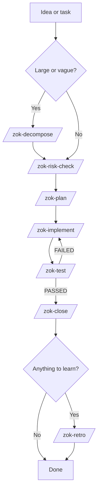
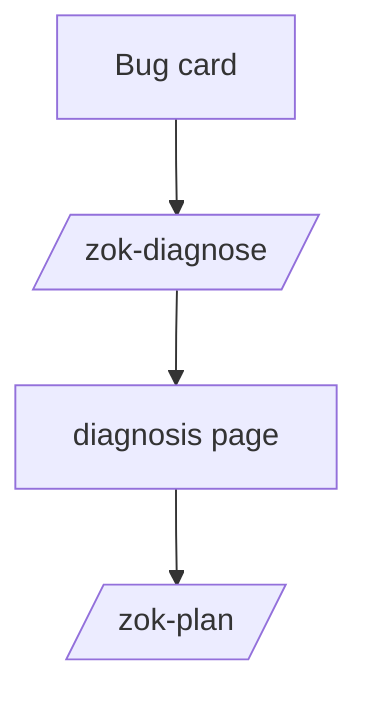

# Shared agent setup

`agents/` is the source of truth for personal skills. One Bash script,
`sync.sh`, links every skill in `skills/` into the skill directory of each
harness, so adding a skill is a one-step operation.

## Daily use

```sh
just agents-setup         # install missing tools and sync skills
just agents-sync          # apply skill links; no tool changes
just agents-sync-no-zoku  # same, but skip and unlink the zok-* skills
just agents-check         # exit nonzero if skill links have drifted
```

## Skills

| | |
|---|---|
| Source | `skills/<name>/SKILL.md` |
| Installed into | `~/.agents/skills` (Codex), `~/.claude/skills` (Claude Code), `~/.pi/agent/skills` (Pi), `${XDG_CONFIG_HOME:-~/.config}/opencode/skills` (OpenCode) |

Claude Code does not read the shared `~/.agents` directory, so its own
directory receives the same links. Every installed skill is a symlink back
into this repository, so harnesses always read the current file.

```sh
./agents/sync.sh                                           # preview
./agents/sync.sh --apply                                   # create and refresh links
./agents/sync.sh --check                                   # exit 1 when links drifted
./agents/sync.sh --apply --exclude 'zok-*'  # per-machine skill set
```

Behaviour:

- Add a skill: create `skills/<name>/SKILL.md`, run `--apply`.
- Remove or rename one: the next `--apply` unlinks it from every harness.
- Only symlinks that resolve into this repository's `skills/` directory are
  replaced or removed. A real file or directory with a skill's name is an
  error, never an overwrite; unrelated files, directories, and links are left
  alone.
- The script is idempotent and needs no Python, `uv`, or network access.

## Shared instructions

`sync.sh` manages skill links only. `AGENTS.md` holds the instruction block
shared by the global harness instruction files (`~/.codex/AGENTS.md`,
`~/.claude/CLAUDE.md`, `~/.pi/agent/AGENTS.md`,
`~/.config/opencode/AGENTS.md`) and is applied to them by hand on each machine.

## Zoku staged workflow

These are personal skills for Zoku projects, separate from any work setup.
Manually invoke one skill at a time with the same card identifier (for example, `ABC-12`):



When a bug's root cause is unknown, diagnose before planning:



1. `zok-plan`: save the goal and acceptance criteria in the card description, and short instructions in its prompt.
2. `zok-implement`: build it; save a short summary. Uncommitted, card stays `doing`.
3. `zok-test`: in a fresh session, check each acceptance criterion; save PASSED or FAILED.
4. `zok-close`: quick check, commit, append the hash, move to `done`. No push.

Failures return to `zok-implement`. The other skills are optional:

| Skill | Use when | Does | Input | Output | Next |
|---|---|---|---|---|---|
| `zok-risk-check` | Unsure how careful to be | Classifies tiny, normal, or risky. Read-only | Card or task text | Size, reason, flow in chat | `zok-plan` |
| `zok-decompose` | Idea too big for one card | Writes a spec and 3 to 7 ordered cards after approval | Project and idea | `Spec:` page, backlog cards | `zok-plan` on the first card |
| `zok-diagnose` | Bug with unknown cause | Reproduces, tests hypotheses, does not fix | Bug card, logs | `<ID> diagnosis` page | `zok-plan` on the same card |
| `zok-retro` | A card taught something | Proposes up to five setup updates, applies approved ones | Card | Retro note, small edits | None |

Shared rules live in `skills/zok-plan/zok-common.md`. Specs, diagnoses, and
retros live in Zoku, not in project repositories. Skills run sequentially
with the cheapest capable model and no subagents by default. Run
`just agents-sync` to install.

Not built yet: `zok-arena` (compare approaches for an uncertain design) and
`zok-parallel` (run independent cards in separate worktrees, merge one at a time).

## First machine / another computer

```sh
git clone <your-dotfiles-remote> ~/Developer/dotfiles
cd ~/Developer/dotfiles
./install.sh
```

For an existing machine with the harnesses and Node.js installed:

```sh
git pull --ff-only
just agents-setup
```

For subsequent changes, edit files here, review and commit them, push, then
run `git pull --ff-only && just agents-sync` on the other computer.
`just update` also refreshes Homebrew packages and reapplies the links.
Git is the synchronization mechanism; no background process auto-commits or
overwrites unpushed work. Machine-specific models, projects, permissions,
credentials, and MCP settings stay in their current local files.

Setup installs missing CodeGraph 1.6.0 via npm; it preserves existing
installations. OpenCode comes from Homebrew. These are tested
baselines, not an enforced cross-machine binary lock. Upgrade deliberately and
re-run setup/check. Skill contents are pinned in Git.

## Authentication and projects

Authenticate Zoku separately in each harness after restart:

- Codex: `codex mcp login zoku` (or the desktop MCP settings).
- Claude Code: `/mcp`, select Zoku and authenticate.
- Pi: `/mcp`, select Zoku and authenticate through the adapter.
- OpenCode: `opencode mcp auth zoku`.

Never commit tokens or copy OAuth databases between computers. Configure the
servers in each harness and leave machine-local settings as they are: Zoku is
the HTTP server `https://zoku-app.com/api/mcp`, CodeGraph is the stdio command
`codegraph serve --mcp`.

Run `codegraph init` once inside each code repository you want indexed. Leave
the default daemon enabled so simultaneous harnesses share an index writer.
Do not synchronize `.codegraph/` indexes through Git or a cloud drive.

## Verification

```sh
bash -n agents/sync.sh agents/setup.sh
./agents/test-sync.sh
./agents/sync.sh --check
just agents-check
```

`test-sync.sh` runs the real script against fixture skills and a throwaway
`HOME`: preview, apply, idempotence, drift, `--exclude`, pruning, relative
links, refusals, the retired typo directory, and option handling. It makes no
network calls and never touches a real harness config.

`--check` is dry: it prints the pending links and exits 1 when a skill is
missing from a harness or a link drifted. It creates nothing.
